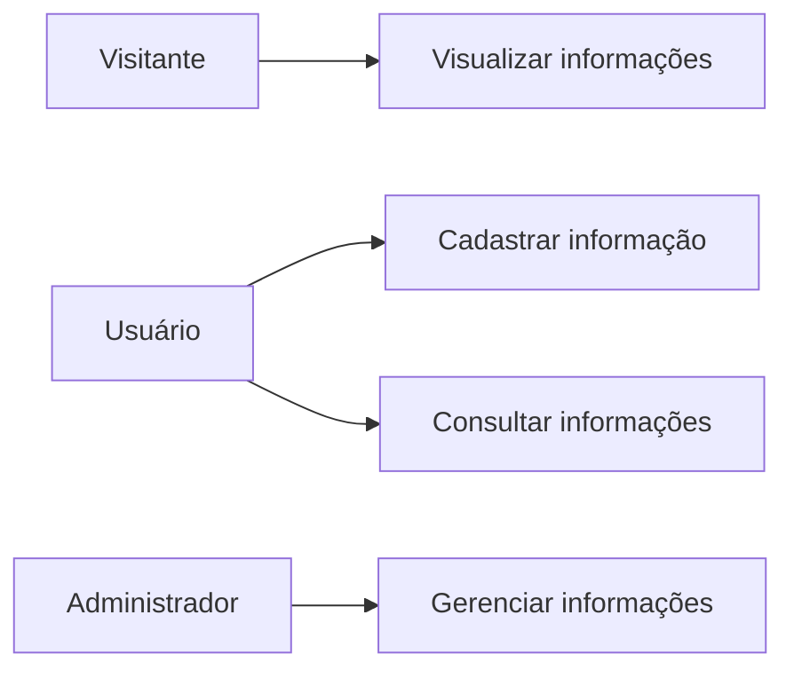
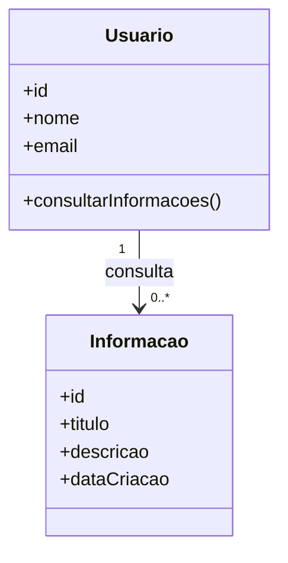

# [Nome do projeto]

> **Resumo:** [Descreva em poucas frases o objetivo do projeto, o problema que resolve e quem pode utilizá-lo.]

## Sobre o projeto

[Apresente o contexto, os principais recursos e o funcionamento geral do sistema.]

## Linguagens e tecnologias

- **Linguagens:** [Ex.: PHP, JavaScript, HTML, CSS]
- **Banco de dados:** [Ex.: SQLite]
- **Frameworks e ferramentas:** [Ex.: listar frameworks, bibliotecas e ferramentas utilizadas]

## Pré-requisitos

Antes de instalar, verifique se você possui:

- PHP 8 ou superior;
- Extensões PHP para SQLite (`php-sqlite3`) e GD (`php-gd`), se utilizadas pelo projeto;
- SQLite;
- Git.

> Ajuste esta lista de acordo com as tecnologias e versões realmente utilizadas no projeto.

## Instalação e execução

1. Clone o repositório:

   ```bash
   git clone https://github.com/RobAbProjADS/alertaCidade.git
   cd alertaCidade
   ```

2. Configure as dependências e o banco de dados, se necessário:

   ```bash
   # Inclua aqui os comandos específicos do projeto
   ```

3. Inicie o servidor local PHP:

   ```bash
   php -S localhost:8000
   ```

4. Acesse [http://localhost:8000](http://localhost:8000) no navegador.

## Colaboradores

| Nome | GitHub | Responsabilidade |
|---|---|---|
| [Nome do colaborador] | [@usuário](https://github.com/usuário) | [Responsabilidade no projeto] |
| [Nome do colaborador] | [@usuário](https://github.com/usuário) | [Responsabilidade no projeto] |

## Casos de uso (Use Case)

Descreva os atores e as ações que cada um pode realizar no sistema. Substitua os exemplos abaixo pelos casos de uso do projeto.



## UML

Inclua os diagramas UML relevantes para documentar a estrutura e o comportamento do sistema. O exemplo abaixo é um diagrama de classes em Mermaid; adapte as classes, atributos e relacionamentos ao projeto.



## Como contribuir

1. Crie uma branch para sua alteração.
2. Faça as alterações e os testes necessários.
3. Abra um pull request descrevendo o que foi feito.

## Licença

[Informe a licença do projeto, se aplicável.]

