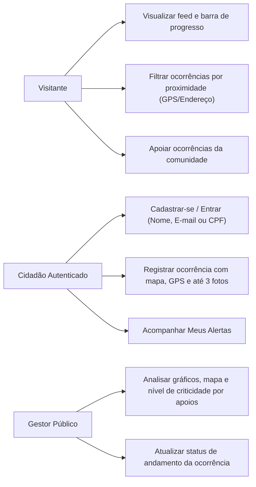
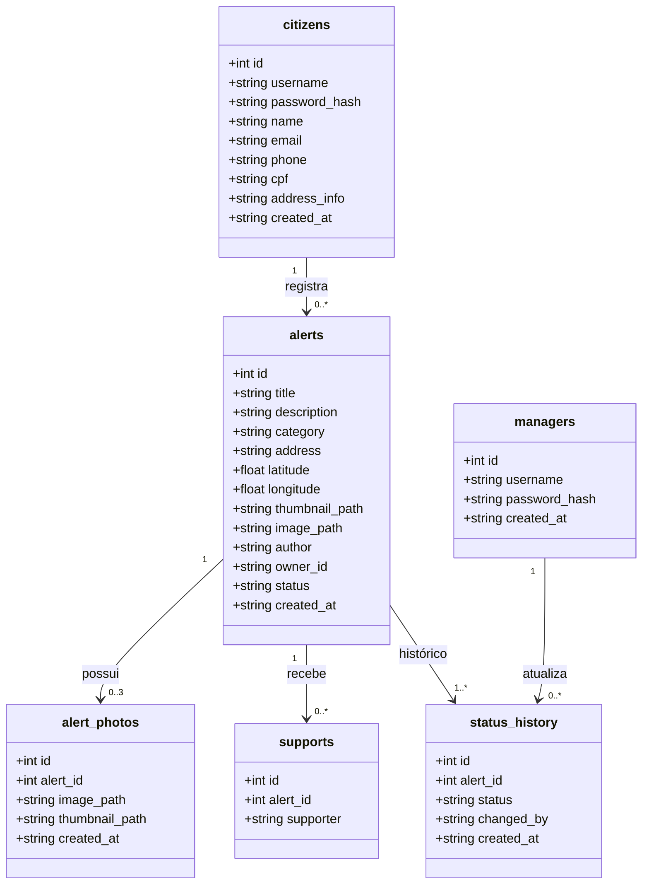

# AlertaCidade

> **Resumo:** Plataforma de Participação Cidadã e Acompanhamento de Ocorrências Urbanas

## Sobre o projeto

O AlertaCidade propõe uma plataforma digital de participação cidadã que permite registrar, visualizar, apoiar e acompanhar ocorrências urbanas, utilizando recursos de geolocalização, classificação inteligente, moderação de conteúdo sensível, nível de criticidade por apoios e acompanhamento por barra de progresso.

## Linguagens e tecnologias

- **Linguagens:** PHP 8+, HTML5, CSS3, JavaScript
- **Banco de dados:** SQLite
- **Bibliotecas e APIs:** Leaflet / OpenStreetMap / Nominatim (mapas e geocodificação), Chart.js (gráficos do painel do gestor)
- **Ferramentas:** VS Code, Git e GitHub

## Pré-requisitos

- PHP 8 ou superior
- Extensões PHP: `pdo_sqlite`, `gd`, `mbstring` e `fileinfo`
- Git

O banco é um arquivo SQLite criado na primeira execução. Não há Composer, npm nem servidor de banco para instalar. O `composer.json` na raiz só registra que o projeto pede PHP 8 ou superior.

Cidadão e gestor usam o mesmo servidor. As duas áreas são caminhos diferentes:

- Cidadão: http://localhost:8080/cidadao/
- Gestor: http://localhost:8080/gestor/

O servidor precisa ser iniciado **dentro** de `MVP` (ou usando os inicializadores rápidos na raiz do projeto). A raiz do repositório não tem `index.php`.

## Instalação do PHP

### Linux (Debian, Ubuntu e derivados)

```bash
sudo apt update
sudo apt install php-cli php-sqlite3 php-gd php-mbstring
php -v
php -m | grep -E 'pdo_sqlite|gd|mbstring|fileinfo'
```

### macOS

Com o [Homebrew](https://brew.sh/). No Apple Silicon o pacote já é nativo (`arm64`).

```bash
brew install php
php -v
php -m | grep -E 'pdo_sqlite|gd|mbstring|fileinfo'
```

O PHP do Homebrew já inclui SQLite, GD, mbstring e fileinfo.

### Windows

Instale o PHP 8 e marque as extensões SQLite, GD, mbstring e fileinfo. Pelo [winget](https://learn.microsoft.com/windows/package-manager/winget/):

```powershell
winget install PHP.PHP.8.3
php -v
php -m
```

Se alguma extensão não aparecer, abra o `php.ini` (o caminho sai em `php --ini`) e retire o `;` do início destas linhas:

```ini
extension=gd
extension=mbstring
extension=fileinfo
extension=pdo_sqlite
extension=sqlite3
```

Feche e abra o terminal depois de mudar o `PATH`.

## Executar

### Opção 1: Inicializadores rápidos (1 clique)

Na raiz do projeto existem 3 arquivos prontos para iniciar o servidor na porta `8080` e abrir o navegador automaticamente:

- **Windows:** dê 2 cliques em `iniciar-windows.bat`
- **Linux:** execute `./iniciar-linux.sh`
- **macOS (Apple):** dê 2 cliques em `iniciar-mac.command` (ou execute `./iniciar-mac.command`)

### Opção 2: Pelo terminal

Clone o repositório e entre na pasta da aplicação:

```bash
git clone https://github.com/RobAbProjADS/alertaCidade.git
cd alertaCidade/MVP
```

No Windows, o mesmo caminho no PowerShell ou no Prompt de Comando:

```powershell
cd alertaCidade\MVP
```

Suba o servidor embutido do PHP. O comando é o mesmo nos três sistemas:

```bash
php -S localhost:8080
```

Para cadastrar outro gestor, o servidor precisa conhecer o token. Pare o processo e suba de novo:

```bash
ALERTACIDADE_SETUP_TOKEN="coloque-um-token-longo-aqui" php -S localhost:8080
```

No PowerShell:

```powershell
$env:ALERTACIDADE_SETUP_TOKEN="coloque-um-token-longo-aqui"
php -S localhost:8080
```

Entre como gestor, abra "Cadastrar gestor" e digite esse mesmo token no formulário. Sem o token, o cadastro não é gravado.

Abra no navegador:

- http://localhost:8080 — escolha cidadão ou gestor
- http://localhost:8080/cidadao/ — feed, cadastro e novas ocorrências
- http://localhost:8080/gestor/ — painel de gestão

### Cadastro e login do cidadão (dados fictícios permitidos no MVP)

Ao criar uma conta na área do cidadão (`http://localhost:8080/cidadao/`), após escolher um nome de usuário e uma senha (mínimo de 8 caracteres), é exibido um **popup de dados cadastrais** (nome completo, e-mail, telefone, CPF/documento e endereço/cidade).

Por se tratar de um **MVP**, **não é necessário informar dados pessoais reais ou sensíveis**: todos os campos aceitam **dados fictícios** (e o popup conta com o botão *"Preencher com dados fictícios"* para facilitar testes rápidos).

Após o cadastro, o login do cidadão pode ser realizado informando **nome** (nome de usuário ou nome completo), **e-mail** ou **CPF**, junto com a senha.

Para entrar como gestor use o usuário `admin`. A senha dessa conta fica só no ambiente local e não é publicada no repositório. Ela é criada no banco na primeira visita.

Pare o servidor com Ctrl+C.

O servidor embutido serve só para desenvolvimento. Antes de publicar, use HTTPS, autenticação adequada e validação de upload no ambiente de produção.

## Colaboradores

| Nome | GitHub |
|---|---|
| Roberta Cristina de Abreu | [@RobAbProjADS](https://github.com/RobAbProjADS) |
| Andressa Gomes | [@andressarag](https://github.com/andressarag) |
| Bryan Lederhos | [@BryanLederhos](https://github.com/BryanLederhos) |

## Casos de uso (Use Case)

Principais atores e ações disponíveis na plataforma:



## UML — Estrutura de Dados

Diagrama representando as entidades do banco de dados SQLite e seus relacionamentos:



## Como contribuir

1. Crie uma branch para sua alteração.
2. Faça as alterações e os testes necessários.
3. Abra um pull request descrevendo o que foi feito.

