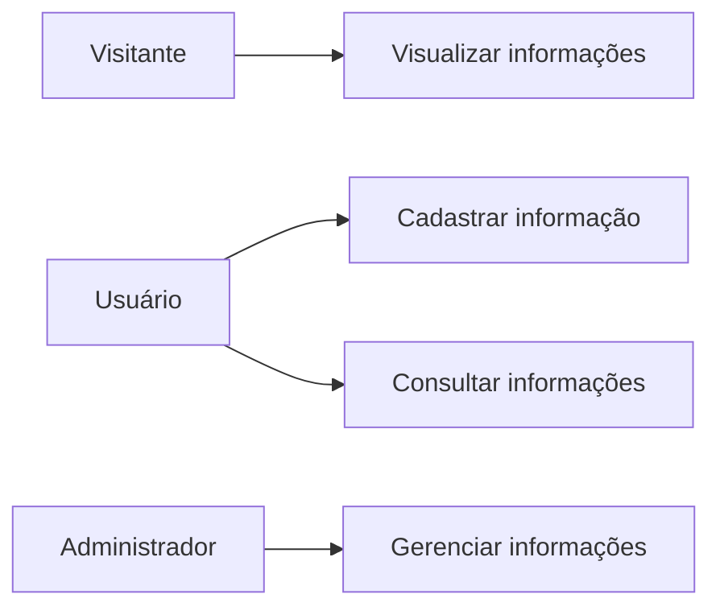
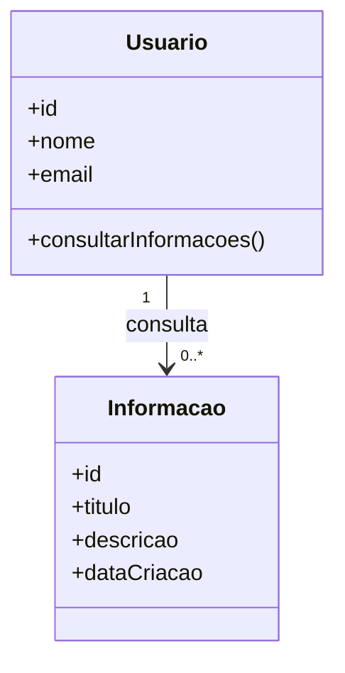

#ALERTACIDADE

> **Resumo:** O AlertaCidade propõe uma plataforma digital de participação cidadã que permite registrar, visualizar, apoiar e acompanhar ocorrências urbanas, utilizando recursos de geolocalizaçãO e imagens. 
## Sobre o projeto

[Apresente o contexto, os principais recursos e o funcionamento geral do sistema.]

## Linguagens e tecnologias

- **Linguagens:** PHP,HTML
- **Banco de dados:** SQLite
- **Frameworks e ferramentas:** VSCODE

## Pré-requisitos

Antes de instalar, verifique se você possui:

- PHP 8 ou superior;
- Extensões PHP para SQLite (`php-sqlite3`) , GD (`php-gd`), MBstring (`php-mbstring`) e FileInfo (`php-fileinfo`)
- Extensões do VSCODE : PHP Server e PHP Intelephense utilizadas pelo projeto;
- SQLite;
- Git.
- GitHub Desktop

## Instalação e execução

1. Clone o repositório:

   ```bash
   git clone https://github.com/RobAbProjADS/alertaCidade.git
   cd alertaCidade
   ```

2. Configure as dependências e o banco de dados, se necessário:

   ```bash
   # sudo apt install php-fileinfo

   # sudo apt install php-gd
   
   #​ sudo apt install php-sqlite3

   # sudo apt install php-mbstring

​​     #
   ```

3. Inicie o servidor local PHP:

   ```bash
   ALERTACIDADE_ADMIN_PASSWORD='troque-esta-senha' php -S localhost:8089

   ```

4. Acesse [http://localhost:8089](http://localhost:8089) no navegador.

## Colaboradores

| Nome | GitHub | Responsabilidade |
|---|---|---|
| Roberta Cristina de Abreu | [@main e @RobAb](https://github.com/RobAbProjADS)
| [Nome do colaborador] | [@usuário](https://github.com/usuário) 

## Casos de uso (Use Case)

Descreva os atores e as ações que cada um pode realizar no sistema. Substitua os exemplos abaixo pelos casos de uso do projeto.



## UML

Inclua os diagramas UML relevantes para documentar a estrutura e o comportamento do sistema. O exemplo abaixo é um diagrama de classes em Mermaid; adapte as classes, atributos e relacionamentos ao projeto.



## Como contribuir

1. Crie uma branch para sua alteração.
2. Faça as alterações e os testes necessários.
3. Abra um pull request descrevendo o que foi feito.


